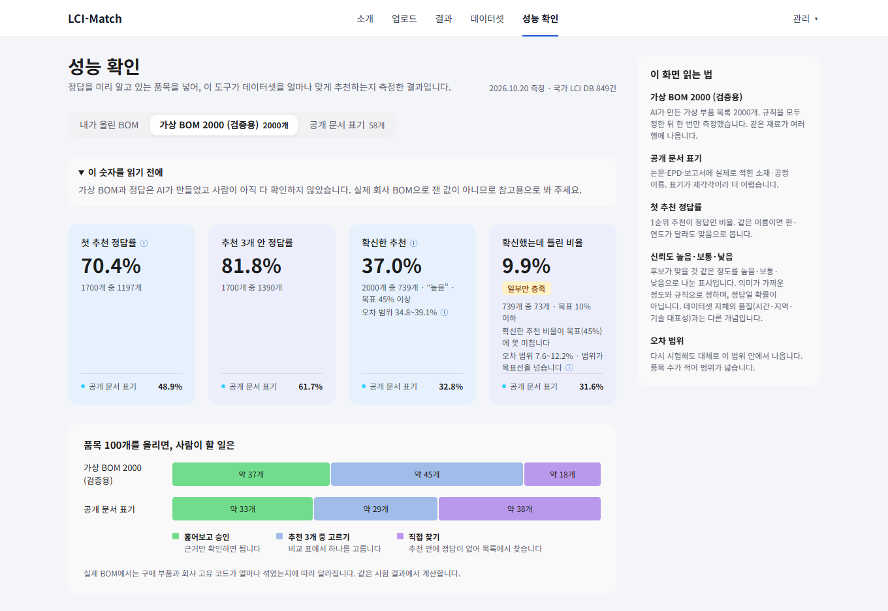

# LCI-Match

> 데스크톱 화면(1280px 이상) 기준으로 만들었습니다.

자동차 부품 BOM(부품 목록)의 각 행에 맞는 **국가 LCI DB(ILCD) 데이터셋 후보**를 찾아 주는 보조 도구입니다.
LCI는 제품·공정 하나의 투입·산출 목록(생명주기 목록), ILCD는 그 데이터를 주고받는 형식입니다.
LCA 실무에서 사람이 하던 "품명 → 데이터셋 찾기" 반복 작업을 줄이는 것이 목적이며, **후보는 사람이 확인·승인해야 확정**됩니다.
비상업 포트폴리오 프로젝트이고, 현재 개발 중입니다.

LCA에서는 사업장 데이터(GtG)의 각 투입 항목을 국가 LCI DB 데이터셋에 연결해야 하며, 보통 사람이 DB에서 행마다 찾아 고릅니다. 이 도구는 AI 검색으로 후보와 신뢰도를 먼저 보여 주어 사람이 처음부터 찾는 행을 줄이는 것을 목표로 합니다. 연결한 데이터셋의 기후변화 영향 결과(배출계수)와 참고용 추정 배출량을 함께 내보냅니다. 인증용 계산이 아닙니다.

## 하는 일

```
BOM 올리기 → 정리 → 후보 검색 → 신뢰도 표시 → 사람이 승인 → 내보내기
```

- 검색은 LLM 없이 사전(소재 약어·표기 사전) → 의미 검색(bge-m3) → 소재·공정이 반대인 후보 뒤로 보내기 → 같은 이름 접기 순서로 합니다. 후보는 행마다 최대 100개를 저장합니다.
- 신뢰도(높음·보통·낮음)는 "이 매칭에 대한 자신감"입니다. 데이터셋의 시간·지역·기술 대표성을 나타내는 데이터 품질 등급(DQR)과는 다릅니다.
- 단위 환산은 코드가 계산합니다. 값이 없으면 지어내지 않고 비워 두며, 환산이 끝나지 않은 행은 승인할 수 없습니다. 연결한 데이터셋의 기후변화 영향 결과(배출계수)와 참고용 추정 배출량을 함께 내보냅니다. 인증용 계산이 아닙니다.
- 후보를 다시 정렬하는 모델과 LLM 판정은 실험해 보고 **쓰지 않기로** 했습니다. 정확도가 오르지 않았고, 같은 품목을 5번 물으면 판정이 절반 넘게 뒤집혔기 때문입니다.

## 얼마나 맞히나

정답을 미리 알고 있는 품목을 넣어 측정했습니다. 앱이 쓰는 설정으로 규칙을 고정한 뒤 데이터마다 한 번씩만 돌렸습니다. 화면은 앱의 **성능 확인** 메뉴입니다.

| 데이터 | 행 수 | 1위 정답률(이름 일치) | 상위 3개 안 | 신뢰도 "높음" 행 / 정답률 |
|---|---|---|---|---|
| 가상 BOM 2000 (검증용) | 2000 (정답 있는 1700) | 70.4% (재료 단위로 묶어 다시 뽑은 구간 65.1~75.2) | 81.8% | 739행 / 90.1% (오류 9.9%, 구간 7.6~12.2) |
| 공개 문서 표기 | 58 | 48.9% (구간 36.2~63.8) | 61.7% | 19행 / 68.4% (오류 31.6%, 구간 10.5~52.6) |



- 가상 BOM 2000은 입력 문장과 정답을 AI가 만든 합성 데이터입니다. 공개 문서에서 본 어려운 유형(약어, 넓은 이름, 구매 부품, DB에 없는 재질)을 일부러 많이 넣었습니다.
- 공개 문서 표기는 실제 문서에 적힌 표기입니다. 정답 라벨은 AI가 붙였고 사람이 검수하기 전입니다.
- 두 값은 **같이** 읽어야 합니다. 앞의 값만 따로 인용하지 않습니다. 구간은 95% 신뢰구간입니다.
- **목표 판정**: 높음 오류율 9.9%는 합격선(10%) 점추정 안이지만 구간 상한 12.2%가 10%를 넘고, 높음 비율 37%는 목표 45%에 못 미칩니다. "5% 이하 달성"이 아닙니다.

**사람이 할 일**: 100개를 올리면 가상 BOM 2000 기준 약 37개는 훑어보고 승인, 45개는 추천 3개 중 고르기, 18개는 직접 찾아야 합니다. 공개 문서 표기는 33/29/38입니다.

## 한계

- 실제 업체 BOM이 없습니다. 가상 BOM과 공개 문서 표기만 썼습니다.
- 같은 재료가 여러 행에 반복되어, 2000행이어도 독립 표본은 그보다 적습니다.
- 정답 라벨은 사람 검수 전입니다.
- 공개 문서 표기 등 앞선 시험은 일부 행의 규격이 검색어에 빠진 채 측정되었습니다.
- 구매 부품과 DB 밖 재질에서 "맞는 후보 없음" 판정이 약합니다(정답 없는 300행 중 33%만 걸러냄).
- 사용 단계는 다루지 않습니다(수송 tkm 데이터셋의 기준 단위는 비어 있음). 라이선스는 아직 정하지 않았습니다.

## 앞으로 (계획)

계획일 뿐 약속이 아닙니다.

- 규격·고분자 약어·합금 번호를 넓힌 범용 사전을 만든다. ← 제품 코드와 영문 약어에서 틀림
- 회사별 사전과 승인 이력 재사용을 만든다. ← 회사마다 표기가 다름
- 범위가 넓은 이름(특수강, 고무 등)은 올리기 전에 보완하라고 안내한다. ← 모호한 입력은 맞히기 어려움
- "맞는 후보 없음" 판정을 강화한다. ← DB에 없는 품목에도 후보를 냄

## 구성

| 폴더 | 내용 |
|---|---|
| `Backend/` | FastAPI, PostgreSQL 16 + pgvector, 적재·인덱싱·검색·세션·평가 결과 API |
| `Frontend/` | Vite + React 19 (JavaScript), 소개·업로드·결과 검토·데이터셋 탐색·성능 확인 화면 |
| `docker-compose.yml` | 개발용 DB(`pgvector/pgvector:pg16`) |

스택: FastAPI · PostgreSQL + pgvector · Ollama(bge-m3) · scikit-learn · React.

## 실행 (Windows PowerShell 기준)

`.env.example`을 `.env`로 복사해 비밀번호를 바꿉니다.

```powershell
Copy-Item .env.example .env
docker compose up -d                       # DB
cd Backend
uv sync
uv run --env-file ../.env python -m app.db.migrate        # 마이그레이션
uv run --env-file ../.env python -m fastapi dev main.py --port 8000
```

```powershell
cd Frontend
npm install
npm run dev:real     # 데이터셋·세션·성능 확인은 실제 서버, 나머지 관리 화면은 아직 틀만 있음
npm run dev          # 전부 mock
```

검색을 쓰려면 국가 DB를 적재하고 인덱스를 만들어야 합니다(`python -m app.ingest`, `python -m app.indexer --activate`, 위와 같이 `uv run --env-file ../.env`로 실행).
자동차 부품 BOM(부품 목록)의 각 행에 맞는 **국가 LCI DB(ILCD) 데이터셋 후보**를 찾아 주는 보조 도구입니다.
LCA 실무에서 사람이 하던 "품명 → 데이터셋 찾기" 반복 작업을 줄이는 것이 목적이며, **후보는 사람이 확인·승인해야 확정**됩니다.
비상업 포트폴리오 프로젝트이고, 현재 개발 중입니다.

## 하는 일

```
BOM 올리기 → 정제(품명·단위·수량) → 후보 검색 → 사람이 확인·승인 → 승인한 행만 내보내기
```

- **하이브리드 검색**: TF-IDF(글자 일치)와 임베딩(bge-m3, 의미 유사)을 RRF로 합쳐 후보를 냅니다.
- **소재·공정 구분**: BOM의 `구분`(소재/공정) 열이 있으면 데이터셋 역할(소재·공정·합본·수송 …)로 후보를 걸러 냅니다.
- **단위 환산은 코드가 계산**합니다. LLM은 계산하지 않습니다. 환산이 끝나지 않은 행은 승인이 거부됩니다.
- 값이 없으면 지어내지 않고 비워 둡니다("기준 단위 없음" 등).
- 탄소 배출량은 계산하지 않습니다. 데이터셋 연결까지만 합니다.

## 구성

| 폴더 | 내용 |
|---|---|
| `Backend/` | FastAPI, PostgreSQL 16 + pgvector, 적재·인덱싱·검색·세션 API |
| `Frontend/` | Vite + React 19 (JavaScript), 소개·업로드·결과 검토·데이터셋 탐색 화면 |
| `docker-compose.yml` | 개발용 DB(`pgvector/pgvector:pg16`) |

스택: FastAPI · PostgreSQL + pgvector · Ollama(bge-m3) · scikit-learn(TF-IDF) · React.

검색을 쓰려면 국가 DB를 적재하고 인덱스를 만들어야 합니다(`python -m app.ingest`, `python -m app.indexer --activate`).
임베딩은 로컬 [Ollama](https://ollama.com)의 `bge-m3`를 씁니다.

## 데이터

**국가 LCI DB 원본(ZIP·XML·목록)은 이 저장소에 없습니다.** 재배포가 금지되어 있어 올리지 않으며,
직접 내려받아 `data/raw/` 아래에 두어야 적재할 수 있습니다. 화면의 샘플 BOM은 공개 자료를 바탕으로 한 가정이며 실제 업체 BOM이 아닙니다.
성능 확인 화면의 측정 결과 파일(`Backend/app/data/eval_reports/`)은 측정 숫자와 데이터셋 번호만 담고 있으며 국가 DB 원본이 아닙니다.

## 시험과 CI

```powershell
cd Backend
uv run pytest -q -rs        # 백엔드

cd ../Frontend
npm run lint
npm run build
```

푸시마다 GitHub Actions(`.github/workflows/ci.yml`)가 같은 검사를 돌립니다.
저장소에 없는 자료(국가 DB 원본 등)가 필요한 시험은 건너뜁니다. 건너뛴 이유는 `-rs` 출력에 나옵니다.


## 현재 상태와 한계

- 업로드 → 결과 검토 → 내보내기까지 실제 서버로 동작합니다. 평가 화면은 아직 예시 데이터입니다.
- 정답셋 기반 정확도 측정은 아직 하지 않았습니다. 그래서 이 문서에는 정확도 수치가 없습니다.
- 사용 단계는 다루지 않습니다. 수송(tkm) 데이터셋의 기준 단위는 비어 있습니다.
- 라이선스는 아직 정하지 않았습니다.
